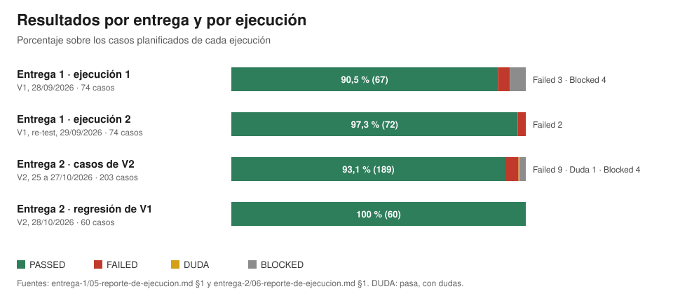
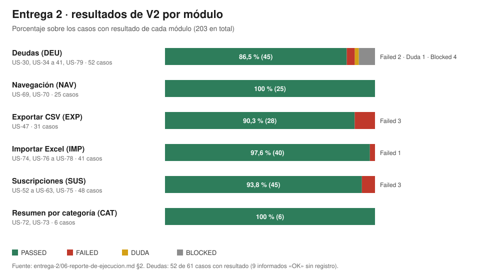

# Entrega 2 · Guía para la defensa

Para cada punto de la consigna, qué archivo abrir y qué mostrar. Para buscar un caso o un defecto,
abrí el archivo y buscá su ID con Ctrl+F (Cmd+F en Mac). En las planillas, cada hoja se llama como
el caso sin el `CP-` (por ejemplo, la hoja `EXP-027` es CP-EXP-027).

## 1. Mapa de la consigna

| Pide la consigna | Archivo | Qué mostrar |
|---|---|---|
| **Parte A** · Historias de usuario de V2, con estructura de pantalla, botones, campos y mocks | [`01-historias-de-usuario-v2.md`](01-historias-de-usuario-v2.md) · [`mocks-png/`](mocks-png/) · [`mocks/`](mocks/) | §2: las 37 historias con su estado. Ejemplo: US-36 «Cargar una deuda suelta» (buscar `US-36:`), con su mock `mocks-png/deudas-nueva.png` |
| **Parte A** · Casos de prueba de V2 | [`02-especificacion-casos-v2.md`](02-especificacion-casos-v2.md) · [`.xlsx`](02-especificacion-casos-v2.xlsx) | 212 casos: índice al principio y una hoja por caso en la planilla |
| **Parte A** · Casos de regresión elegidos de V1 | [`04-ejecucion.md`](04-ejecucion.md) · [`.xlsx`](04-ejecucion.xlsx) · [ADR-027](../docs/adr/027-regresion-por-seleccion-de-riesgo.md) | Apartado «Regresión de V1»: criterio de selección por riesgo, motivo de cada caso incluido y los 14 excluidos. En la planilla, columna «Test regresivo» del «Índice» |
| Implementación de V2 con IA, con los mismos requerimientos | [`07-ia-agentes-y-prompts.md`](07-ia-agentes-y-prompts.md) | §1: cómo se separó la especificación de la implementación. §5: los prompts. §8: qué prompt y qué herramienta produjo cada PR |
| Pasarle a la IA los defectos para que los corrija | [`07-ia-agentes-y-prompts.md`](07-ia-agentes-y-prompts.md) §6 | La plantilla y los 7 PR que corrigieron los 22 defectos de V1 |
| Ejecución de los casos de V2 | [`04-ejecucion.md`](04-ejecucion.md) · [`.xlsx`](04-ejecucion.xlsx) | Resultado por caso y detalle de cada caso que no es PASSED |
| Ejecución de la regresión de V1 | [`04-ejecucion.md`](04-ejecucion.md), apartado «Regresión de V1» | Los 60 casos de V1 sobre V2 |
| Confirmación de los defectos de V1 | [`04-ejecucion.md`](04-ejecucion.md), «Regresión de V1», «Defectos de V1 confirmados en V2» | Los 22 defectos repetidos sobre V2 con su resultado |
| **Parte B** · Organización del equipo | [`README.md`](README.md) «Equipo» · [`07-ia-agentes-y-prompts.md`](07-ia-agentes-y-prompts.md) §3 | Quién hizo qué, y qué se hizo con IA y qué sin IA |
| **Parte B** · % PASSED, FAILED y BLOCKED, con un gráfico | [`graficos/`](graficos/) · [`04-ejecucion.md`](04-ejecucion.md) «Reporte de ejecución» (hoja «Resumen y criterios» de la planilla) | Los dos gráficos de abajo |
| **Parte B** · Casos que cambiaron de estado en cada entrega | Sección 3 de esta guía · [`04-ejecucion.md`](04-ejecucion.md) «Reporte de ejecución» | La tabla de cambios |
| **Parte B** · Defectos de V2 y a qué funcionalidad afectan | [`05-reportes-de-defectos.md`](05-reportes-de-defectos.md) · [`.xlsx`](05-reportes-de-defectos.xlsx) | Tabla «Resumen»: columna «Historia». Una hoja por defecto en la planilla |
| **Parte B** · Agentes de IA, IDEs y prompts | [`07-ia-agentes-y-prompts.md`](07-ia-agentes-y-prompts.md) | §2: herramientas y modelos |
| **Parte B** · Demo de V2 | https://biyu-rust.vercel.app | Sección 5 de esta guía |

## 2. Gráficos

## 3. Casos que cambiaron de estado

| Cuándo | Caso | Antes | Después | Por qué |
|---|---|---|---|---|
| Entrega 1, ejecución 1 → 2 | CP-CFG-011 | FAILED | PASSED | DEF-017: faltaba la configuración inicial (US-68), implementada en #173 |
| Entrega 1, ejecución 1 → 2 | CP-CFG-012 a CP-CFG-015 | BLOCKED | PASSED | Dependían de US-68 (DEF-017) |
| Entrega 1 → Entrega 2 (regresión) | CP-ACC-004 | FAILED | PASSED | DEF-005 corregido (#188) |
| Entrega 1 → Entrega 2 (regresión) | CP-CFG-004 | FAILED | PASSED | DEF-006 corregido (#192) |
| Entrega 1 → Entrega 2 (regresión) | Los otros 58 casos de la regresión | PASSED | PASSED | Sin cambios: V2 no rompió lo que ya andaba |
| Entrega 2 (V2) | CP-DEU-001, 003 y 011 | DUDA | PASSED | Los casos tenían pasos faltantes o mal ordenados: se corrigieron en `casos/deu.md` y se volvieron a ejecutar |

Los casos de V2 se ejecutaron por primera vez en esta entrega: no tienen un estado anterior.

## 4. Casos para mostrar si piden salir de las slides

| Para mostrar | Caso | Dónde |
|---|---|---|
| Un caso con pasos detallados, en lenguaje simple | CP-DEU-005 · No se puede compartir un gasto si falta cuánto te deben | `02` md y hoja `DEU-005`. Resultado: `04`, PASSED |
| Un caso que falla, con su defecto | CP-EXP-027 · Tocar fuera cierra sin descargar → **DEF-030** | Caso en `02` (hoja `EXP-027`). Resultado y detalle en `04` («Detalle de los casos que no son PASSED»). Defecto en `05` |
| Un defecto que afecta a dos casos | CP-DEU-024 y CP-DEU-025 → **DEF-037** («US$» en Nueva deuda) | `04` y `05` |
| Un caso bloqueado por una función no implementada | CP-DEU-055 · Gasto compartido con varias personas (US-82) | `02` y `04`: BLOCKED, con el motivo |
| Un caso en DUDA | CP-DEU-002 · Gasto compartido de $120.000,00 en 12 cuotas | `04`: se cumple, pero el pedido usa otros parámetros porque US-82 no existe |
| Un caso de API (negativo, sin sesión u otro usuario) | CP-SUS-032 → **DEF-034** (HTTP 500 en lugar de 404) | `02` y `04`, `05` |
| Un caso de regresión que cambió de estado | CP-ACC-004 · Contraseñas que no cumplen los criterios (DEF-005) | `03` §3 (la regla por la que entró) y `04` «Regresión de V1» |
| La confirmación de un defecto de V1 | DEF-005 o DEF-021 | `03` §5 |
| La trazabilidad de una historia a sus casos | US-47 (Exportar CSV) | `casos/exp.md` §1 «Trazabilidad CA-k → casos» |
| El prompt con el que se implementó una historia | US-56 a US-59 (Suscripciones, sesión 3) | `07` §5.4 y el registro de §8 |

## 5. Demo de V2

Deploy: https://biyu-rust.vercel.app. Recorrido sugerido, una pantalla por feature nueva:

1. **Barra de navegación** (US-69): Registrar, Resumen, Deudas y Suscripciones.
2. **Gasto compartido** (US-34): en Registrar, un gasto con «Gasto compartido» encendido; después, en Deudas, la deuda vinculada.
3. **Deudas** (US-36 a US-40): cargar una deuda suelta, saldarla y deshacer.
4. **Suscripciones** (US-52, US-75, US-56): alta con la vista previa del calendario, y pausar.
5. **Resumen por categoría** (US-72 y US-73): la torta y el detalle de una categoría.
6. **Exportar CSV** (US-47) e **Importar Excel** (US-74 a US-78): exportar un mes e importar `mocks/importar-excel-ejemplo.xlsx`.

Antes de la demo, probá el recorrido en el deploy: la ejecución con IA se hizo en local, y el repaso
manual del equipo se hizo en el deploy.

## 6. Preguntas probables y qué responder

| Pregunta | Respuesta | Dónde está |
|---|---|---|
| ¿La ejecución fue manual? | No toda. 21 casos de V2 se ejecutaron a mano y 21 de Suscripciones los informó el equipo; 161 de V2 y los 60 de la regresión los ejecutó Claude Code con Playwright. Después, el equipo repasó a mano todos los casos en el deploy de Vercel (Mariana en Deudas, Santiago en Navegación, Joaquín en Exportar CSV, Valentina en Importar Excel y Micaela en Suscripciones), y Joaquín ejecutó a mano los 60 de la regresión | `04` «Quién ejecutó cada caso» y «Desvíos respecto de lo planificado» |
| ¿Por qué 203 casos con resultado si el catálogo tiene 212? | Los 9 restantes son de Deudas: el equipo los informó como «OK» sin registrar el resultado, y no se repitieron | `04` «Reporte de ejecución» |
| ¿Por qué se recortó el catálogo de 672 a 206? | Se quitaron los casos que repetían una regla con otro valor, los de funciones no implementadas y los de ancho de pantalla o testids repetidos | `04` «Reporte de ejecución» · `equivalencia-ids.md` |
| ¿Qué historias no se implementaron? | US-80 a US-84. Sus casos quedan BLOCKED o se quitaron del catálogo hasta que existan | `01` §2 |
| ¿Por qué no se cumple el criterio de salida 3? | 4 casos de prioridad Alta están BLOCKED porque dependen de US-82 (varias personas), que no se implementó | `04` «Criterios de salida» |
| ¿DEF-035 y DEF-036 son defectos? | Puede que no: el caso esperaba 403 y la API responde 401 (DEF-035), y en las filas no bloqueadas espera `data-blocked="false"` cuando la app no pone el atributo (DEF-036). Quedan abiertos hasta que el PO decida si se corrige la app o el caso | `05` |
| ¿Cómo se aseguraron de que la IA no cambiara los requerimientos? | Una sesión escribe la historia y la congela en un issue; otra sesión, nueva, implementa leyendo solo el issue y tiene que parar si algo es ambiguo | `07` §1 |
| ¿Qué IA usaron? | Claude Code (escritorio y web) con Claude Opus 5.5 en casi toda la implementación. Antigravity tuvo prompts preparados | `07` §2 |
