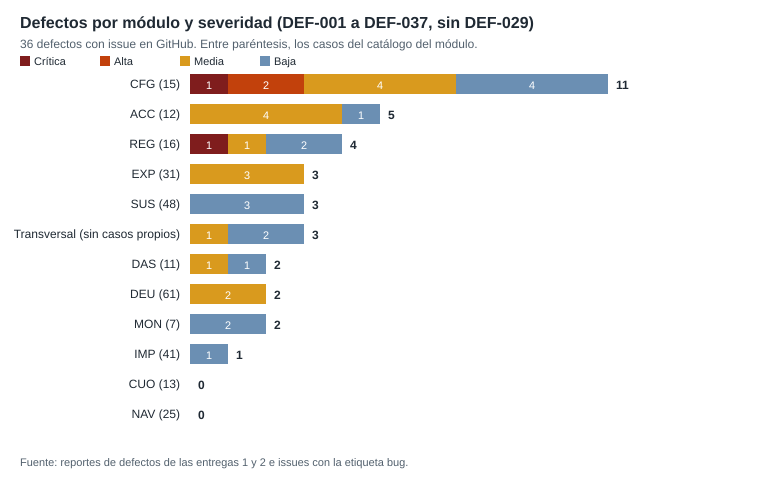

# Entrega 3 · Análisis de defectos y post-mortem de las actividades de testing

Tarea [#342](https://github.com/Joaconz/Biyu/issues/342), dentro de la épica de calidad ([#326](https://github.com/Joaconz/Biyu/issues/326)). Cierra el criterio de `docs/roadmap.md` §V3 «Está escrito el análisis de los defectos encontrados a lo largo del proyecto y el post-mortem de las actividades». Cubre de V1 (Entrega 1, 2026-09-28 a 2026-10-05) a V3 (Entrega 3, hasta 2026-11-14).

## 0. Fuentes y límites de los datos

| Dato | Fuente |
|---|---|
| Defectos, severidad, caso, historia, «encontrado en» | [`entrega-1/04-reportes-de-defectos.md`](../entrega-1/04-reportes-de-defectos.md) (DEF-001 a DEF-028) y [`entrega-2/05-reportes-de-defectos.md`](../entrega-2/05-reportes-de-defectos.md) (DEF-030 a DEF-037) |
| Fechas de apertura y cierre | Issues de GitHub con la etiqueta `bug` (`gh issue list --state all --label bug`): 36 issues, todos cerrados |
| Resultados de ejecución | `docs/11-reporte-ejecucion-v1.md`, `entrega-1/05-reporte-de-ejecucion.md`, `entrega-2/04-ejecucion.md`, [`05-reporte-ejecucion-automatizada.md`](05-reporte-ejecucion-automatizada.md) |
| Decisiones | ADR-027, ADR-028, `docs/07-plan-de-testing.md`, [`02-seleccion-automatizacion.md`](02-seleccion-automatizacion.md), [`03-seleccion-regresion.md`](03-seleccion-regresion.md) |
| Historia de trabajo | `git log` de `main` (327 commits sin contar merges, 2026-08-19 a 2026-11-14) |

Lo que hay que tener presente al leer los números:

- Hay **36 defectos con issue** (DEF-001 a DEF-037). **DEF-029 no existe**: se retiró el 2026-10-27 porque era un error de un caso (ver §1.5). No se cuenta.
- **El módulo no está en los reportes como campo.** Lo asigné según la historia afectada de cada defecto (columna «Historia» de los reportes); es un criterio mío y se puede discutir. DEF-009 (nace del caso CP-CUO-003) cuenta en Configuración porque la historia es US-45 (cuentas). DEF-016 (deudas, «latente en el schema») cuenta en Deudas. Los defectos de accesibilidad, `lang` y `data-testid` globales van como «Transversal».
- **La técnica de prueba que encontró cada defecto no está registrada como campo.** Lo que sí consta es el *origen*: caso del catálogo, ataque libre, exploración de bordes, uso manual o suite automatizada. Uso eso (§1.4) y solo nombro una técnica del plan (`docs/07-plan-de-testing.md` §3) cuando el reporte la nombra.
- **Las fechas de los issues no son las de hallazgo.** Los DEF-001 a DEF-016 se abrieron el mismo día que se encontraron, pero los DEF-030 a DEF-037 se encontraron el 2026-10-27 y se cargaron como issue el 2026-10-30 (los reportes dicen «Issue: A crear»). Por eso doy dos tiempos para V2 (§1.6). Tampoco el cierre del issue es la confirmación: los de V1 se confirmaron sobre V2 el 2026-10-28.

## 1. Análisis de los defectos

### 1.1 Resumen por versión

| Versión | Defectos | Críticos | Altos | Medios | Bajos | Cómo se encontraron |
|---|---|---|---|---|---|---|
| V1 (DEF-001 a DEF-028) | 28 | 2 | 2 | 12 | 12 | 74 casos ejecutados (2 FAILED) y mucho más afuera del catálogo (§1.4) |
| V2 (DEF-030 a DEF-037) | 8 | 0 | 0 | 4 | 4 | 203 casos con resultado (9 FAILED) |
| V3 | **0 registrados** | 0 | 0 | 0 | 0 | 361 casos automatizados (184 de V3 y 177 de regresión), 0 FAILED (ver §1.7 por lo que esto no dice) |
| **Total** | **36** | **2** | **2** | **16** | **16** | |

Al cierre de V3 no queda ningún defecto abierto. Los dos Críticos son DEF-004 (un `NaN` como monto se guardaba y rompía el Resumen: «$NaN,undefined») y DEF-022 (el setup de US-68 dejaba afuera de la app a cuentas existentes). Los dos Altos son DEF-017 (US-68 sin implementar) y DEF-023 (pantalla en blanco intermitente tras crear la cuenta).

### 1.2 Por módulo y severidad

| Módulo | Casos del catálogo | Crítica | Alta | Media | Baja | Total |
|---|---|---|---|---|---|---|
| CFG · Configuración | 15 | 1 | 2 | 4 | 4 | **11** |
| ACC · Acceso | 12 | 0 | 0 | 4 | 1 | **5** |
| REG · Registro | 16 | 1 | 0 | 1 | 2 | **4** |
| SUS · Suscripciones | 48 | 0 | 0 | 0 | 3 | **3** |
| EXP · Exportar CSV | 31 | 0 | 0 | 3 | 0 | **3** |
| Transversal (accesibilidad, `lang`, `data-testid`) | — | 0 | 0 | 1 | 2 | **3** |
| DEU · Deudas | 61 | 0 | 0 | 2 | 0 | **2** |
| MON · Monedas | 7 | 0 | 0 | 0 | 2 | **2** |
| DAS · Resumen | 11 | 0 | 0 | 1 | 1 | **2** |
| IMP · Importar Excel | 41 | 0 | 0 | 0 | 1 | **1** |
| CUO · Cuotas | 13 | 0 | 0 | 0 | 0 | **0** |
| NAV · Navegación | 25 | 0 | 0 | 0 | 0 | **0** |
| **Total** | | **2** | **2** | **16** | **16** | **36** |

Lo que muestra la tabla:

- **Configuración concentra 11 de 36 (31 %)**, y 6 de esos 11 son una misma familia, la siembra y el setup (US-43 y US-68): DEF-010, 017, 022, 023, 026 y 028. Los reportes las encadenan: DEF-026 es «derivado de DEF-010» y DEF-028 «viene del arreglo de DEF-010» (#191) y de DEF-023. Es decir, el arreglo de una falla de la siembra produjo otra.
- **Cuotas y Navegación tienen cero defectos** con 13 y 25 casos. No lo leo como «módulos sólidos» sin más: la ausencia de defectos puede ser también falta de exploración (§1.4). Lo que sí se ve es que la cantidad de casos no predice los defectos: Deudas tiene 61 casos y 2 defectos; Configuración, 15 casos y 11.
- **Exportar CSV: 3 defectos Medios en 31 casos y los tres en el mismo componente** (`ExportTransactionsDialog.tsx`, cierre de la hoja). Un solo arreglo (PR [#365](https://github.com/Joaconz/Biyu/pull/365)) los cerró.

### 1.3 Severidad

| Severidad | V1 | V2 | Total | % |
|---|---|---|---|---|
| Crítica | 2 | 0 | 2 | 6 % |
| Alta | 2 | 0 | 2 | 6 % |
| Media | 12 | 4 | 16 | 44 % |
| Baja | 12 | 4 | 16 | 44 % |

La severidad la fijó quien reportó (`docs/07-plan-de-testing.md` §5). **La prioridad nunca se fijó**: en los 36 reportes la columna «Prioridad» dice «A definir por el PO» (o una sugerencia entre paréntesis en DEF-004 y DEF-017). El plan separa severidad de prioridad a propósito; en la práctica la única dimensión usada fue la severidad.

### 1.4 Técnica u origen: qué encontró cada defecto

| Origen | V1 | V2 | Defectos |
|---|---|---|---|
| Caso escrito del catálogo (el resultado del caso o un paso del caso destapó el defecto) | 6 | 8 | V1: DEF-006, 007, 008, 011, 017, 020 · V2: DEF-030 a 037 |
| Ataque libre de la sesión `test-adversary` (#75), fuera del catálogo o variante de un caso | 12 | 0 | DEF-001, 002, 003, 004, 005, 009, 010, 012, 013, 014, 015, 016 |
| Exploración de bordes de la Entrega 1 (EXP-01, EXP-02) | 2 | 0 | DEF-018, 019 |
| Uso manual en producción | 2 | 0 | DEF-021 (celular, montos grandes), DEF-022 (cuenta preexistente) |
| Testeo del 2026-10-05: suite e2e contra producción o la CI | 3 | 0 | DEF-023, 027 (la suite llegó al límite de altas de Auth), 028 (fallo de un Preview) |
| Testeo exploratorio del 2026-10-05 | 3 | 0 | DEF-024 (foco en diálogos), 025, 026 |
| **Total** | **28** | **8** | |

Tres lecturas, todas con el dato a la vista:

1. **En V1, 22 de 28 defectos (79 %) aparecieron fuera de los casos escritos.** Los 74 casos dieron 2 FAILED (CP-ACC-004 y CP-CFG-004). El resto salió de ataque libre, exploración, uso real y e2e. Es el argumento más fuerte a favor de reservar tiempo de exploración: leído solo por el catálogo, V1 mostraba 2 casos FAILED y un 97 % de PASSED (`entrega-1/05-reporte-de-ejecucion.md`).
2. **En V2 la relación se invirtió: 8 de 8 salieron de casos.** No hubo sesión de ataque libre ni de exploración registrada en V2; los defectos de V2 son los que un caso anticipó. Esto no significa que V2 esté más limpio: significa que V2 se probó solo con el catálogo. No tengo cómo saber cuántos defectos de V2 quedaron sin ver.
3. **Valores límite** es la única técnica que los reportes nombran como causa de un hallazgo concreto (DEF-012 y DEF-013, «valores límite no escritos»: monto extremo y monto USD muy chico). Los otros reportes no dicen qué técnica del plan los derivó.

Además, la suite automatizada de V3 destapó regresiones que **no recibieron número de DEF** (§1.7).

### 1.5 De la aplicación o del caso

| Clase | Defectos | Qué pasó |
|---|---|---|
| **Defecto de la aplicación** | 33 de 36 | La aplicación se comportaba distinto de lo especificado |
| **Error del caso** | DEF-035 (y DEF-029, retirado) | DEF-035: PostgREST responde 401 al rol `anon` y el caso esperaba 403; se corrigió el caso (commit `7f0d268`, PR [#368](https://github.com/Joaconz/Biyu/pull/368)). DEF-029: la baja responde 204 sin cuerpo y el caso esperaba 200 con `null`; se quitó el caso y el defecto se retiró de los reportes |
| **Mixto: atributo de automatización** | DEF-036 | La app no ponía `data-blocked="false"`. El reporte ya dudaba («parece un error del caso, o un atributo de automatización por completar»). Se resolvió cambiando la app para que el caso y la automatización distingan los dos estados. Lo cuento como defecto de la aplicación, con la salvedad de que el comportamiento visible para el usuario no cambió |
| **De proceso, no de código** | DEF-003 | US-66 no llegó a producción por un error de merge (el código existía en otra rama) |

Además, hay **correcciones de casos que no tuvieron número de defecto**: los oráculos de contraseña de CP-ACC-003 y CP-ACC-004 estaban desactualizados desde que se agregó US-67 (`docs/11-reporte-ejecucion-v1.md` §7) y CP-DEU-001, 003 y 011 se corrigieron el 2026-10-27 por pasos faltantes o mal ordenados (`entrega-2/04-ejecucion.md`). Esos cinco casos corregidos más DEF-029 y DEF-035 son los casos mal escritos que quedaron documentados; no hay un registro sistemático de casos corregidos, así que no calculo un porcentaje.

Hay dos defectos cuyo cierre no está confirmado en las condiciones originales: **DEF-023** (Alta) se cerró sin reproducirlo en 16 altas porque era intermitente («el equipo lo cierra y se reabre si reaparece»), y DEF-021, DEF-027 y DEF-028 se confirmaron «en parte» (WebKit con viewport de iPhone 13 en lugar de un iPhone real; límite de altas simulado con un 429; siembra lenta simulada con demoras). De hecho, el test de humo `smoke.spec.ts` volvió a caer de forma intermitente en la CI el 2026-11-11 con una causa probable parecida a la de DEF-023 (`05-reporte-ejecucion-automatizada.md` §5), y DEF-021 volvió a fallar en la CI el 2026-11-07 (§1.7).

### 1.6 Cuánto tardaron en corregirse

Días corridos entre la apertura del issue y su cierre (36 issues):

| Grupo | Issues | Mismo día | 1 día | 4 a 5 días | 7 días | Mediana | Promedio |
|---|---|---|---|---|---|---|---|
| V1 | 28 | 9 | 6 | 8 | 5 | 1 día | 2,8 días |
| V2 (desde que se abrió el issue) | 8 | 0 | 8 | 0 | 0 | 1 día | 1,0 día |
| Todos | 36 | 9 | 14 | 8 | 5 | 1 día | 2,4 días |

| Severidad | Issues | Mediana | Promedio | Máximo |
|---|---|---|---|---|
| Crítica | 2 | — | 0,5 días (0 y 1) | 1 día |
| Alta | 2 | — | 0 días (mismo día los dos) | 0 días |
| Media | 16 | 2,5 días | 3,1 días | 7 días |
| Baja | 16 | 1 día | 2,3 días | 7 días |

- **Lo grave se corrigió rápido:** los 4 defectos Críticos o Altos se cerraron como máximo al día siguiente. Es coherente con el criterio de salida de V1 (cero Críticos abiertos).
- **Entre Medios y Bajos no hay orden por severidad:** los Medios tardaron más que los Bajos (mediana 2,5 contra 1 día). Los cierres se agrupan por fecha, no por severidad: 6 el 2026-09-29, 3 el 2026-10-02, 8 el 2026-10-03, 11 el 2026-10-05 y 8 el 2026-10-31. Cinco defectos tardaron 7 días porque entraron en el último lote de V1 (DEF-006, 007, 010, 011 y 015: tres Medias y dos Bajas). Esto es consistente con que la prioridad no se haya fijado nunca (§1.3): se corrigió por lotes de PR, no por una cola ordenada.
- **V2 desde el hallazgo:** los 8 defectos de V2 se encontraron el 2026-10-27, se abrieron como issue el 2026-10-30 y se cerraron el 2026-10-31 (PR [#365](https://github.com/Joaconz/Biyu/pull/365) a [#368](https://github.com/Joaconz/Biyu/pull/368)). Desde el hallazgo hasta el cierre son **4 días corridos**, y 3 de esos 4 días fueron de carga del issue, no de corrección.
- No puedo dar horas ni tiempo de trabajo de corrección: GitHub da fecha y hora de apertura y cierre, pero no cuánto se trabajó en cada uno. Las medianas en días corridos usan solo la fecha.

### 1.7 Lo que el conteo de defectos no dice

- **V3 tiene cero defectos registrados porque la ejecución de V3 es solo automatizada** (361 de 361 PASSED, 0 FAILED). No hubo ataque libre, exploración ni repaso manual de V3 (`05-reporte-ejecucion-automatizada.md` §3 y §6). Cero defectos acá es «la suite no encontró nada nuevo», no «V3 no tiene defectos».
- **La suite detectó regresiones durante el desarrollo de V3 que se corrigieron sin abrir un DEF.** Dos con evidencia en el mensaje del commit: `fab0456` (2026-11-07, «falló DEF-021 en la CI»: las tablas para lector de pantalla volvieron a ensanchar la página a 360 px con el monto máximo) y `d0edfac` (2026-11-07, «5 specs e2e no podían clickear dentro del diálogo» por un `view-transition-name` permanente). Un tercer arreglo, `fd04238` (2026-11-10, toques que atravesaban la barra flotante), no dice cómo se encontró. Son defectos reales detectados antes de mergear, que no figuran en las 36 filas: el conteo de §1.1 **subestima** los defectos que V3 efectivamente produjo y corrigió. Es una decisión razonable (no hacía falta un issue para algo que la CI detuvo antes de `main`), pero conviene saber que el número no es comparable con V1 y V2.

## 2. Post-mortem de las actividades de testing

### 2.1 Organización del equipo

**Qué se planeó.** Cinco personas con frentes separados desde V2 (dos desarrollan, tres prueban), «los devs no prueban su propio código» y **propiedad cruzada**: cada tester diseña ciertos módulos y ejecuta los de otro (`docs/07-plan-de-testing.md` §1).

**Qué funcionó**

- **El flujo de un defecto fue ágil y trazable.** Reporte con formato fijo (pasos, esperado, obtenido, evidencia, entorno, causa probable) → issue → fix → confirmación con un caso. 36 de 36 issues cerrados; los reportes de V2 incluyen causa probable y medidas (por ejemplo los 26 px que se corre el botón «US$» en DEF-037), y se corrigieron en 4 PR en un día.
- **Separar severidad de prioridad y exigir «Test de regresión» en el reporte** dejó el material para las confirmaciones: los 22 defectos de V1 corregidos que esperaban confirmación se re-testearon sobre V2 (18 confirmados, 3 en parte, 1 no concluyente) y los 8 de V2 más DEF-023 se confirmaron sobre V3 (9 de 9, `05-reporte-ejecucion-automatizada.md` §3).
- **Los criterios de salida por versión** (`docs/07-plan-de-testing.md` §6) fueron un instrumento real: V1 no se pudo cerrar mientras CP-REG-013 estuviera bloqueado (`docs/11-reporte-ejecucion-v1.md` §7) y V2 documentó que el criterio 3 «no se cumple» (cuatro Alta bloqueados por US-82).

**Qué no funcionó**

- **La propiedad cruzada no se aplicó en V2.** El propio reporte lo dice dos veces: «La propiedad cruzada del plan no se aplicó» (`entrega-2/04-ejecucion.md` §6, Deudas y Navegación y Deudas 015–035). La ejecución de V2 la hizo Claude Code en local; el equipo repasó a mano el deploy y, para 21 casos de Suscripciones y 9 de Deudas, lo único que hay es un «ok» informado por mensaje, sin repetirse ni detallarse: **30 de los 212 casos de V2 (14 %) no tienen una ejecución con evidencia propia**. El plan (`docs/07-plan-de-testing.md` §2) sigue diciendo que la regresión la hacen «testers, por propiedad cruzada»; no hay una enmienda que registre el cambio.
- **La prioridad de los defectos quedó sin fijar (§1.3)** y el orden de corrección fue por lotes (§1.6).
- **La dependencia entre historias frenó casos.** US-82 (compartir con varias personas) y US-83 no existían en V2: cuatro casos Alta quedaron BLOCKED y 51 casos de Importar (US-80, US-81) se quitaron del catálogo para reescribirse. Se escribieron casos de funciones que todavía no estaban.
- **El conteo de defectos de V2 no es comparable con el de V1** (§1.4, §1.7): distintos modos de prueba, distintas condiciones de ejecución.

### 2.2 Diseño de casos y el recorte de 672 a 206

**Qué pasó.** El catálogo de V1 tenía 74 casos. El profesor lo corrigió por casos poco especificados; la auditoría de ADR-028 encontró cinco problemas (casos que juntan varios datos con un solo veredicto, la variante por API como un paso más sin request concreto, resultados esperados vagos, «el usuario de prueba» sin definir, datos mezclados con prerrequisitos). Un ejemplo concreto: CP-ACC-004 dio FAILED solo por el servidor y eso tapó que la UI sí cumplía (DEF-005). La respuesta fue un **estándar de caso atómico** (ADR-028) y casos de V2 escritos así desde el principio. El catálogo de V2 llegó a **672 casos** y el 2026-10-27 se recortó a **206** (más 6 de Resumen por categoría: 212). Se quitaron los que repetían una regla con otro valor, los de funciones todavía no implementadas y los de ancho de pantalla o testids repetidos (`entrega-2/04-ejecucion.md` §1; correspondencia en [`entrega-2/equivalencia-ids.md`](../entrega-2/equivalencia-ids.md)). Se renumeró todo.

**Qué funcionó**

- **Los casos atómicos permitieron atribuir cada falla a una sola causa**: los tres FAILED de Exportar apuntan a un solo componente y DEF-037 se reconoce en dos casos (CP-DEU-024 y 025) con la misma medición.
- **Los casos separados de UI y API** destaparon cosas que un solo caso mezclado habría escondido: DEF-034 y DEF-035 son del comportamiento HTTP de la API, que solo se ve con el request concreto.
- **Los PR-nn** (procedimientos comunes) y la regla «un usuario por caso» permitieron automatizar después sin reescribir la preparación (`entrega-3/02-seleccion-automatizacion.md`: usuario nuevo por test, PR-01).
- **El recorte fue una decisión documentada, no un hachazo:** el motivo está escrito, existe la tabla de equivalencia de IDs, y la regresión de V3 (177 casos) se construyó con una regla clara (ADR-027 y `03-seleccion-regresion.md`) en lugar de «todo».

**Qué no funcionó**

- **672 casos fue sobreproducción.** Un catálogo que pierde el 69 % de sus casos (466) y cuyo primer motivo declarado es «repetían una regla con otro valor» estaba multiplicando casos por valor en lugar de uno por clase de equivalencia (lectura mía; el reporte no lo dice con esas palabras, ni cuenta los casos quitados por cada motivo). El costo fue real: trabajo de diseño descartado, un renumerado completo y el riesgo de que la trazabilidad apunte a casos que ya no existen. No hay registro de las horas invertidas en los casos quitados.
- **Se escribieron casos de funciones inexistentes.** Los casos de US-80, US-81, US-82 y US-83 se redactaron antes que las historias: 51 casos de Importar se quitaron y otros BLOCKED esperaron a V3. Los casos de V3 de esas historias son nuevos (CP-IMP-042 a 058, CP-DEU-085 a 095, entre otros).
- **El recorte tuvo costo de cobertura.** Entre lo quitado hay casos de ancho de pantalla, uno que necesitaba un Pixel 7 con TalkBack y dos casos en DUDA (`entrega-2/04-ejecucion.md` §6); no consta que se hayan reemplazado por otra verificación, así que la accesibilidad con lector de pantalla real y los dispositivos reales quedaron sin caso.
- **Los oráculos desactualizados se detectaron al ejecutar, no al diseñar.** CP-ACC-003 y 004 (US-67 se agregó al spec después de diseñar el catálogo) y CP-DEU-001, 003 y 011 se corrigieron durante la ejecución.

### 2.3 Agentes de IA para implementar, ejecutar y reportar

Evidencia del repo: 266 de 327 commits (81 %) llevan `Co-Authored-By: Claude` en su mensaje; los PR de fixes de V2 se hicieron con agentes («Santiago corrige con IA»); la ejecución de V1 la hizo Claude Code con un runner Playwright supervisado; la de V2 la hizo Claude Code sobre el stack local, con repaso manual posterior; los reportes de defectos de V2 traen la marca de haberse escrito durante la ejecución automatizada (entorno, commit, mediciones).

**Qué funcionó**

- **Velocidad y cobertura de ejecución:** el 2026-10-27 se ejecutaron 129 casos de V2 (EXP 31, IMP 41, SUS 27, DEU 24 y CAT 6) y el 2026-10-28, los 60 de regresión de V1, con el resultado de cada corrida registrado (`entrega-2/04-ejecucion.md`). La regresión de V1 se corrió cuatro veces seguidas hasta tener una corrida limpia.
- **Reportes de defectos de alta calidad.** Los de V2 traen causa probable con archivo y líneas (DEF-030: `ExportTransactionsDialog.tsx`, condición `e.target === e.currentTarget`), medidas (DEF-037) y la hipótesis marcada como «sin confirmar» cuando no se pudo verificar (DEF-031).
- **Honestidad sobre lo no verificado:** el agente marcó «confirmado en parte» (DEF-021, 027, 028), «no concluyente» (DEF-023), «parece un error del caso» (DEF-035, 036) y «no se investigó a fondo ni se corrigió nada». Eso permitió decidir con información.
- **El agente detecta cuándo no es seguro actuar:** en V1 se negó a crear cuentas de prueba en producción (`docs/11-reporte-ejecucion-v1.md` §7). La ejecución se rehízo contra Supabase local sin mover datos reales.
- **El fix de un defecto salió con su test** (convención de `docs/07-plan-de-testing.md`): DEF-034 a 036 llegaron con tests e2e y pgTAP en el mismo commit.

**Qué no funcionó**

- **El mismo agente implementa y prueba.** El plan prohíbe que los devs prueben su código, pero la persona que conduce al agente implementador y el agente que escribe el test pueden ser la misma sesión. Los tests de V3 se escribieron «en el mismo PR que la historia» (`02-seleccion-automatizacion.md`, orden sugerido, punto 3) y los de US-80 a US-91 «por criterio de aceptación, sin el ID en el título»: eso es cobertura, pero verificada por quien escribió el código. No hay en el repo ninguna medición que muestre cuánto aportan esos tests más allá de pasar (§2.4).
- **La ejecución por IA hizo que la regla de propiedad cruzada dejara de aplicarse** (§2.1) y desplazó el control humano al repaso manual, que en V2 no tiene evidencia por caso («informados como ok»). En el reporte de V3 el repaso manual directamente no se repite.
- **Un script que corre «mucho» confunde con «se probó bien».** Las dos primeras corridas de la regresión de V1 en V2 fallaron por la preparación y por la configuración de Supabase local, no por la app: el costo de depurar el entorno quedó oculto en «cuatro corridas completas». En V3, 179 fallas por timeouts con la máquina cargada se descartaron como no representativas. No encontré un criterio escrito de cuándo se descarta una corrida.
- **Un caso mal escrito se ejecuta con la misma fidelidad que uno bien escrito:** el agente corrió DEF-035 tal cual y lo reportó como defecto (el reporte ya sospechaba que era del caso). La revisión del caso antes de ejecutarlo es el único filtro.
- **Trazabilidad opaca del autor.** `git log` muestra 27 commits con autor «Claude» y 239 más con el trailer: no se puede reconstruir cuánto de un reporte es juicio del tester y cuánto texto generado.

### 2.4 Automatización: Playwright, Vitest y pgTAP en la CI

**Qué se hizo.** La suite corre contra Vite y Supabase local en cada PR (job `e2e`, PR [#364](https://github.com/Joaconz/Biyu/pull/364), 2026-10-31): **290 tests de Playwright**, **1131 de Vitest** y **1354 de pgTAP** (43 archivos). 361 casos (184 de V3 y 177 de regresión) quedaron en PASSED, sin regresiones respecto de la Entrega 2; los 9 casos de confirmación (8 defectos de V2 y DEF-023) pasan (`05-reporte-ejecucion-automatizada.md`).

**Qué funcionó**

- **La suite ya mostró valor en el propio desarrollo:** detectó dos regresiones en V3 antes de llegar a `main` (§1.7) y confirmó con un test la corrección de los 8 defectos de V2 y de DEF-023.
- **Es repetible.** Está pensada para que un tercero levante el schema desde cero y corra la suite (`npm run test:e2e`, `npm test`, `npm run test:db`) y el reporte HTML queda como artefacto de la CI (14 días).
- **pgTAP es rápido (2 s)** y cubre exactamente lo que más importa en este sistema: RLS (par «otra sesión → cero filas / `anon` → permission denied»), invariantes y concurrencia.
- **El criterio «cada elemento interactivo lleva `data-testid`»** (`docs/07-plan-de-testing.md` §2) se convirtió en defecto cuando faltó: DEF-015 y DEF-036 son faltantes de `data-testid` o de atributo. No tengo un dato que muestre cuántas fallas de la suite se debieron a locators.

**Qué no funcionó**

- **Tiempo.** El job `e2e` tarda 17,2 minutos (Playwright 11,2 a 15,1 min); el de `db` 1,5 y el de `web` 0,5. Un PR chico paga 17 minutos. Con la CI de los últimos 100 runs (todas las ramas) hubo 84 éxitos y 16 fallas; no distingo cuántas fallas fueron de infraestructura, flakiness o regresión real.
- **Flakiness.** `smoke.spec.ts` cayó en `main` el 2026-11-11 (271 verdes y 1 caído): el botón «Siguiente» quedaba deshabilitado porque el formulario se vuelve a montar tras el alta y pierde el monto tipeado, como en DEF-023. Se endureció el test, pero el reporte lo deja como «riesgo hasta ver varias corridas en verde». Y el job `e2e` falló dos veces por DNS al instalar Chromium (se agregaron 3 reintentos en [#416](https://github.com/Joaconz/Biyu/pull/416)).
- **100 % de PASSED no es evidencia de cobertura.** No hay en el repositorio medición de cobertura de código ni de mutación (no hay configuración de `coverage` en `package.json`, Vitest ni la CI). La suite pasó 361 de 361 en el registro formal, y los tests se escribieron junto con las historias (§2.3): no se sabe cuántos fallarían si se rompiera una regla. Un caso por criterio de aceptación puede dejar sin mirar un matiz de un paso (lo dice el propio reporte).
- **Un test cubre varios casos en US-80 a US-91.** El criterio de PASSED es «pasaron todas las pruebas que lo cubren»; no hay un mapeo caso a test 1 a 1 para esas historias, aunque la planilla nombra los tests de cada caso.
- **Quedó sin automatizar lo que más cuesta ver:** lo visual (espaciado, legibilidad), la corrida contra el deploy de Vercel con WebKit y Firefox (existe como `SMOKE_URL`, pero no corre en la CI) y el repaso manual con otras personas.
- **No se midió el tiempo de la ejecución manual.** No existe número manual contra el cual comparar los 17 minutos; la ganancia solo se puede decir cualitativamente (§4 de `05-reporte-ejecucion-automatizada.md`).

## 3. Lecciones y qué haría distinto

Cada una apunta a un hecho de arriba y a algo que se puede hacer.

| # | Lección | Evidencia | Qué hacer |
|---|---|---|---|
| 1 | **Reservar una sesión de exploración por versión, con su propio registro.** En V1, 22 de 28 defectos salieron de afuera del catálogo; en V2 no hubo sesión y 0 defectos nuevos fuera de casos | §1.4 | Agregar al plan de cada versión una sesión de ataque libre con tope de tiempo y un campo «Origen» en el reporte de defectos (caso, ataque libre, exploración, uso real, automatizado) |
| 2 | **Escribir casos por partición, no por valor.** 672 casos produjeron 206 vigentes | §2.2 | Antes de escribir un módulo, listar sus particiones y valores límite (tabla de `docs/07-plan-de-testing.md` §3) y escribir un caso por clase; que `spec-critic` rechace un caso que solo cambia el dato de otro |
| 3 | **No escribir casos de historias que todavía no existen.** 4 Alta BLOCKED y 51 casos de Importar quitados | §2.1, §2.2 | Un caso nace cuando la historia entra a «En desarrollo»; antes, solo criterios de aceptación numerados |
| 4 | **Registrar técnica y módulo como campos del reporte de defectos.** Hoy hubo que reconstruirlos leyendo los títulos | §0 | Agregar «Módulo», «Técnica» y «Origen» a la plantilla de `docs/07-plan-de-testing.md` §5 |
| 5 | **Fijar la prioridad o eliminar la columna.** 36 de 36 dicen «A definir por el PO» y los Medios tardaron más que los Bajos | §1.3, §1.6 | El PO fija prioridad en el triage, antes de que el defecto entre a un lote de corrección; si no se va a usar, sacarla del formato |
| 6 | **Cuando se arregla algo derivado de una causa, hacer el análisis de impacto.** DEF-010 produjo DEF-026 y DEF-028; DEF-017, DEF-022 y DEF-023 | §1.2 | Al cerrar un defecto, correr los casos del módulo vecino (ya lo hace la regla 3 de ADR-027) y anotar en el reporte «puede afectar a…» |
| 7 | **Ejecución por IA con control humano real, no solo informado.** 30 de 212 casos de V2 sin ejecución propia registrada | §2.1, §2.3 | Si el agente ejecuta, el tester cruzado repasa una muestra con evidencia (captura o traza) por caso; un «ok» sin dato no cuenta como PASSED |
| 8 | **Separar quién implementa de quién escribe el test.** Los tests de V3 nacieron con la historia | §2.3, §2.4 | Los tests de regresión de una historia los escribe una sesión distinta de la que la implementó, a partir de los criterios de aceptación y no del código |
| 9 | **Medir lo que la suite verifica.** 361/361 sin ninguna medición de cobertura ni mutación | §2.4 | Agregar cobertura de `src/domain/` (Vitest) y una pasada de mutación sobre `src/domain/` y las RPC críticas antes del cierre; reportar el porcentaje de mutantes muertos |
| 10 | **Tratar la flakiness como defecto.** `smoke.spec.ts` y DEF-023 comparten causa probable | §1.5, §2.4 | Abrir un `DEF` por cada falla intermitente de CI, con el reintento como evidencia; no cerrar sin reproducir más que como «riesgo» |
| 11 | **Dar número a lo que la CI detiene antes de `main`.** V3 corrigió al menos 2 regresiones sin DEF | §1.7 | Registrar el defecto en el PR (campo «Defecto asociado») o con un issue `bug` liviano, para poder comparar versiones |
| 12 | **Aceptar que el 100 % automatizado no reemplaza una pasada manual del deploy.** Lo visual y WebKit/Firefox quedaron afuera | §2.4 | Una pasada manual acotada en el deploy por versión, con 10 a 15 casos Alta elegidos por riesgo, y medir su tiempo para tener una base contra los 17 minutos de la CI |

## 4. Datos que no pude verificar

- **Módulo y clase de cada defecto:** son mi clasificación a partir de las historias y de los textos de los reportes (§0). La cuenta de «33 de 36 defectos de la aplicación» deja aparte DEF-003 (proceso), DEF-035 (caso) y DEF-036 (mixto).
- **Técnica de prueba por defecto:** no está registrada; solo el origen. Solo DEF-012 y DEF-013 nombran una técnica (valores límite).
- **Fecha de hallazgo de los V1 posteriores a la primera sesión:** para DEF-018 a DEF-020 los reportes no dan fecha de hallazgo (el issue se abrió el 2026-10-02); DEF-023 a DEF-028 se encontraron en el testeo del 2026-10-05, que coincide con su fecha de apertura.
- **Tiempo de trabajo de corrección y de diseño de casos:** no se registró. Del recorte de 672 a 206 no hay horas ni cantidad por motivo, solo las tres razones y los 51 casos de US-80 y US-81.
- **Cuántos defectos de V2 quedaron sin detectar:** no hay forma de estimarlo con los datos; no hubo sesión exploratoria en V2 ni repaso manual de V3.
- **Qué parte del texto de los reportes fue autoría del tester y cuál del agente:** el trailer `Co-Authored-By` no lo discrimina.
- **Corridas de CI:** la proporción de 84 verdes y 16 rojas es de los últimos 100 runs que lista `gh run list` (todas las ramas); no se desglosó la causa de cada rojo.
