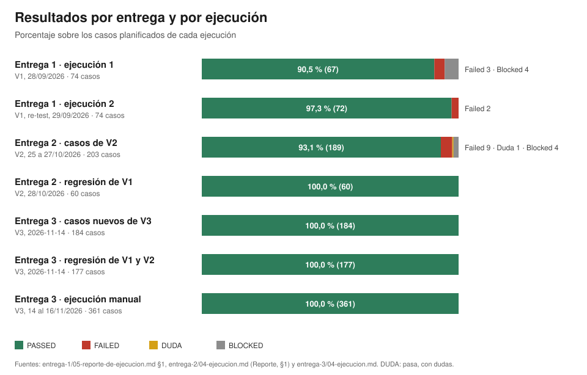
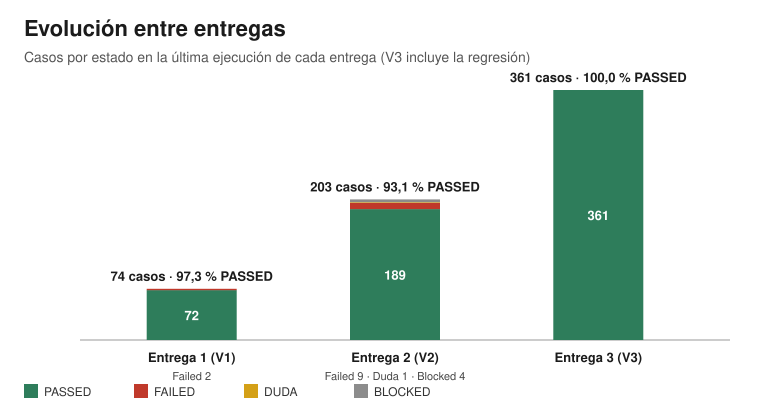

# Entrega 3 · Reporte final de ejecución

Tarea [#341](https://github.com/Joaconz/Biyu/issues/341), dentro de la épica de calidad ([#326](https://github.com/Joaconz/Biyu/issues/326)). Resume lo ejecutado en las tres entregas: el resultado de V3 (casos nuevos y regresión), qué casos cambiaron de estado entre entregas y los defectos. Los detalles están en [`04-ejecucion.md`](04-ejecucion.md) (por caso), [`05-reporte-ejecucion-automatizada.md`](05-reporte-ejecucion-automatizada.md) (la suite y su comparación con la Entrega 2) y [`06-analisis-y-post-mortem.md`](06-analisis-y-post-mortem.md) (análisis de defectos y post-mortem).

## 1. Qué se ejecutó

| | |
|---|---|
| Versión probada | `main` en `40ab30e` (merge de [#424](https://github.com/Joaconz/Biyu/pull/424)), 2026-11-14, con todas las historias de V3 mergeadas |
| Quién | La suite automatizada, corrida con IA (Claude Code) sobre el stack local: Playwright (290 tests), Vitest (1131) y pgTAP (1354, en la CI y en local) |
| Casos | 184 casos nuevos de V3 y 177 de regresión de V1 y V2: 361 en total |
| Ejecución manual del equipo | **No hubo en la Entrega 3.** En la Entrega 2 el equipo repasó a mano los casos en el deploy; esta corrida no lo repite |

## 2. Resultado de V3

| Conjunto | Casos | PASSED | FAILED | BLOCKED | % PASSED |
|---|---|---|---|---|---|
| Casos nuevos de V3 (automatizados) | 184 | 184 | 0 | 0 | 100,0 % |
| Regresión de V1 y V2 (automatizada) | 177 | 177 | 0 | 0 | 100,0 % |
| Regresión manual | — | — | — | — | no se ejecutó |
| **Total** | **361** | **361** | **0** | **0** | **100,0 %** |

Por módulo, los casos de V3 son ACC 4, CFG 26, DAS 21, DEU 37, IMP 17, NAV 16, REG 41 y SUS 22; la regresión suma CAT 3, CUO 10, EXP 27, MON 5 y el resto de los módulos (tabla completa en [`04-ejecucion.md`](04-ejecucion.md)).

Qué dice y qué no dice este 100 %:

- Un caso es PASSED si pasaron todas las pruebas que lo cubren. Un test de Playwright puede cubrir varios casos por criterio de aceptación, así que es cobertura del comportamiento, no una repetición paso a paso del caso.
- No hay medición de cobertura de código ni de mutación (ver `06-analisis-y-post-mortem.md` §2.4). Que todo pase no mide cuánto detectaría la suite si se rompiera una regla.
- La planilla registra la tercera corrida completa local, que dio 290 de 290. La primera dio 285 de 290 y la segunda 289 de 290; las diferencias fueron del entorno (un contenedor detenido y timeouts con la máquina cargada) y están explicadas en [`05-reporte-ejecucion-automatizada.md`](05-reporte-ejecucion-automatizada.md) §5.
- **La CI de `main` sobre este mismo commit dio 289 de 290:** falló CP-CFG-028 (llegó `/settings?period=2026-11` y el test esperaba `/settings`). Acá pasa y la CI de los PR anteriores pasaba. Ver §5.

## 3. Gráficos

Porcentajes de PASSED, FAILED, DUDA y BLOCKED de cada ejecución de las tres entregas:



Casos por estado en la última ejecución de cada entrega:



| Entrega | Ejecución | Casos | PASSED | FAILED | DUDA | BLOCKED | % PASSED |
|---|---|---|---|---|---|---|---|
| 1 (V1) | ejecución 1, 2026-09-28 | 74 | 67 | 3 | 0 | 4 | 90,5 % |
| 1 (V1) | ejecución 2 (re-test), 2026-09-29 | 74 | 72 | 2 | 0 | 0 | 97,3 % |
| 2 (V2) | casos de V2, 2026-10-25 a 27 | 203 | 189 | 9 | 1 | 4 | 93,1 % |
| 2 (V2) | regresión de V1, 2026-10-28 | 60 | 60 | 0 | 0 | 0 | 100,0 % |
| 3 (V3) | casos nuevos, 2026-11-14 | 184 | 184 | 0 | 0 | 0 | 100,0 % |
| 3 (V3) | regresión de V1 y V2, 2026-11-14 | 177 | 177 | 0 | 0 | 0 | 100,0 % |

Los porcentajes no son comparables sin cuidado: cada entrega ejecutó un conjunto distinto de casos (V1 era el núcleo, V2 sumó Exportar, Importar, Suscripciones y Deudas, V3 sumó edición, borrado definitivo y UX) y con otra forma de ejecutar (manual con IA en V1 y V2, solo automatizada en V3).

## 4. Casos que cambiaron de estado en cada entrega

**Entrega 1, de la ejecución 1 a la 2.** Cinco casos pasaron a PASSED: CP-CFG-011 (FAILED) y CP-CFG-012 a 015 (BLOCKED), porque DEF-017 (US-68 sin implementar) se corrigió. Siguieron en FAILED CP-ACC-004 (DEF-005) y CP-CFG-004 (DEF-006).

**De la Entrega 1 a la 2 (regresión de V1 en V2).** Los dos casos que habían fallado en V1 pasaron en V2 porque sus defectos se corrigieron: CP-ACC-004 (DEF-005) y CP-CFG-004 (DEF-006). Los otros 58 casos que eran PASSED en V1 siguieron en PASSED.

**De la Entrega 2 a la 3.** Los 177 casos de regresión ya tenían resultado en la Entrega 2. Pasan a PASSED 20 que antes no lo eran, cada uno por una razón conocida; ninguno que pasaba falla ahora:

| Resultado en la Entrega 2 | Casos | Resultado en V3 | Por qué cambió |
|---|---|---|---|
| FAILED por un defecto de V2 | 9 | PASSED | Se corrigió el defecto: CP-EXP-027, 028 y 029 (DEF-030 a 032), CP-IMP-024 (DEF-033), CP-SUS-032 (DEF-034), CP-SUS-022 (DEF-035, error del caso), CP-SUS-048 (DEF-036, error del caso), CP-DEU-024 y 025 (DEF-037) |
| BLOCKED | 4 | PASSED | US-82 (compartir con varias personas) se implementó en V3: CP-DEU-013, 055, 056 y 057 |
| No ejecutado | 6 | PASSED | Sin resultado anterior: CP-DEU-018, 022, 036, 037, 038 y 039 |
| DUDA | 1 | PASSED | CP-DEU-002 no tenía resultado firme |
| PASSED (sin cambios) | 157 | PASSED | Coinciden |

Los 184 casos nuevos de V3 no tienen resultado anterior. De esos, 7 corresponden a US-100 y 12 a US-95, US-96 y US-99, historias que se implementaron en los últimos días de la entrega (PR [#422](https://github.com/Joaconz/Biyu/pull/422) a [#425](https://github.com/Joaconz/Biyu/pull/425)).

## 5. Defectos

| Versión | Defectos | Críticos | Altos | Medios | Bajos |
|---|---|---|---|---|---|
| V1 (DEF-001 a DEF-028) | 28 | 2 | 2 | 12 | 12 |
| V2 (DEF-030 a DEF-037) | 8 | 0 | 0 | 4 | 4 |
| V3 | 0 registrados | 0 | 0 | 0 | 0 |
| **Total** | **36** | **2** | **2** | **16** | **16** |

(DEF-029 se retiró el 2026-10-27 por ser un error de un caso y no se cuenta. El detalle por módulo, origen y tiempo de corrección está en [`06-analisis-y-post-mortem.md`](06-analisis-y-post-mortem.md) §1.)

- **Abiertos:** ninguno de los 36. Los 36 issues con etiqueta `bug` están cerrados.
- **Corregidos:** los 36.
- **Confirmados en V3:** los 8 de V2 (DEF-030 a DEF-037) y DEF-023 de V1, que había quedado intermitente en la Entrega 2: **9 de 9** (sección «Confirmación de defectos» de [`04-ejecucion.md`](04-ejecucion.md)).
- **Nuevos de V3:** ningún caso falló, así que no hay defectos nuevos con número. Esto subestima lo producido: durante V3 la suite detectó regresiones que se corrigieron sin abrir un DEF (commits `fab0456` y `d0edfac`; `06-analisis-y-post-mortem.md` §1.7).

**Hallazgos de esta ejecución que no son defectos registrados:**

- **CP-CFG-028 intermitente en la CI de `main`.** El test abre «Categorías», vuelve con el botón de la pantalla y espera la URL `/settings`; en la corrida de la CI de `40ab30e` llegó `/settings?period=2026-11`. Pasa en local, también 5 de 5 repetido de a uno. Falta decidir si es una carrera real de la aplicación con el parámetro `period` o una aserción demasiado estricta. Mientras tanto, la CI de `main` está en rojo en ese commit.
- **CP-CFG-040 con 4 workers.** Se pasó de los 30 s en dos corridas con la máquina cargada; pasa de a uno y con 2 workers. Es lento, no un defecto de la aplicación.
- **Edge runtime local detenido.** Hizo fallar CP-SUS-024 y CP-IMP-040 en la primera corrida local; es del entorno (el contenedor llevaba 3 días detenido), no de la aplicación.
- **La sección «Confirmación de defectos» no estaba en `main`.** El PR [#420](https://github.com/Joaconz/Biyu/pull/420) se había mergeado a una rama ya mergeada, y nunca llegó. Se restauró al regenerar la planilla de esta entrega.

## 6. Criterios de «Terminado» de V3

| Criterio (`docs/roadmap.md` §V3) | Estado |
|---|---|
| Casos de V3 diseñados y ejecutados; regresión de V1 y V2 ejecutada | Cumplido, de forma automatizada (361 de 361 en PASSED) |
| Defectos de V2 confirmados y cerrados o justificados | Cumplido (9 de 9) |
| Reporte final con % PASSED, FAILED y BLOCKED y cambios de estado entre entregas | Este documento |
| La suite corre en CI y falla el build cuando debe | La CI corre las tres suites; falló en `main` por CP-CFG-028 (el build falla cuando un test falla) |
| Reporte de ejecución automatizada, comparable con el manual | [`05-reporte-ejecucion-automatizada.md`](05-reporte-ejecucion-automatizada.md); no hay una ejecución manual medida contra la cual dividir el tiempo |
| Análisis de defectos y post-mortem | [`06-analisis-y-post-mortem.md`](06-analisis-y-post-mortem.md) |
| Un tercero puede clonar el repo, levantar el schema desde cero y correr la suite | **Sin verificar:** no se probó en una máquina limpia |

## 7. Cómo se regeneran los datos

```bash
npx vitest run --reporter=json --outputFile=entrega-3/ejecucion/vitest-resultados.json
PLAYWRIGHT_JSON_OUTPUT_NAME=entrega-3/ejecucion/playwright-resultados.json npx playwright test --reporter=json --workers=2
npx supabase test db > pgtap.txt   # y pasar las líneas «archivo .. ok» a entrega-3/ejecucion/pgtap-resultados.txt
python entrega-3/fuentes/generar_ejecucion.py
python entrega-3/fuentes/generar_graficos_finales.py
```
